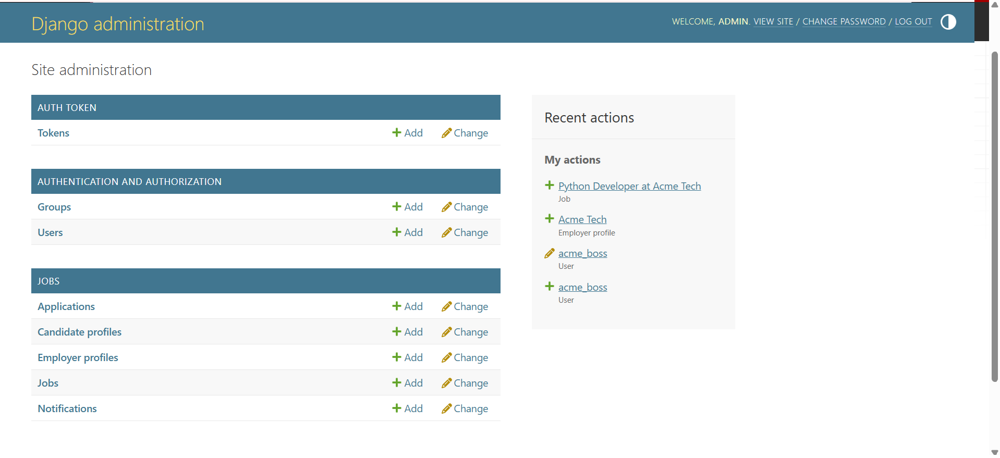
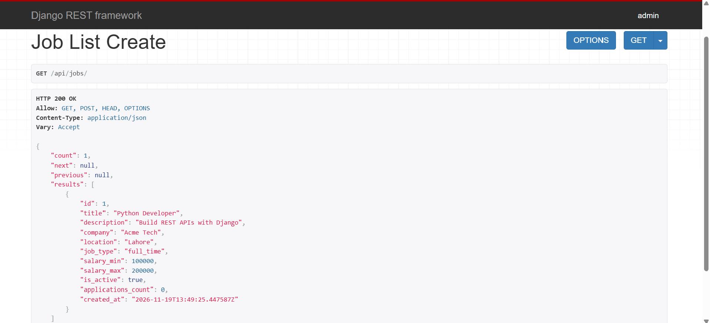
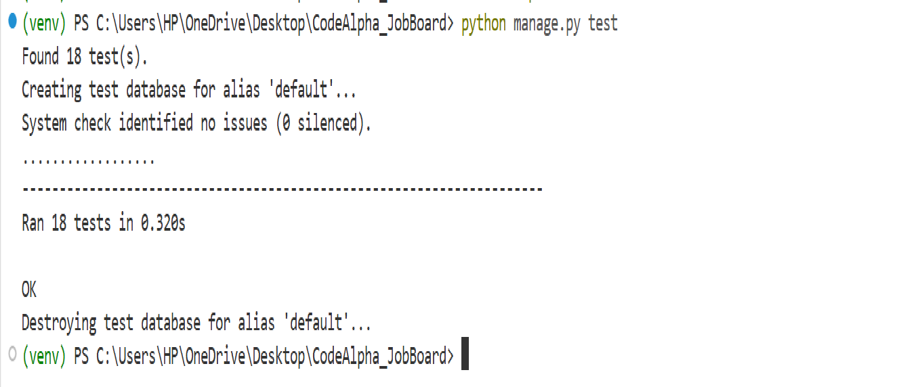

# Job Board Platform

Backend project for the CodeAlpha Backend Development Internship (Job Board task).
Employers post jobs, candidates upload a resume and apply, and employers track
and update each application.



## Features

- Token-based signup and login with two roles: **employer** and **candidate**
- Employers post, edit and delete their own jobs
- Public job list with search and filters (keyword, location, job type, company, minimum salary)
- Candidates upload a resume (PDF, DOC or DOCX, max 5 MB)
- Candidates apply to jobs, and cannot apply twice to the same job
- Application tracking with statuses: applied, reviewing, shortlisted, rejected, hired
- In-app notifications: employers are told about new applications, and candidates about status changes
- Employer statistics report (jobs posted, applications by status)
- Django admin panel for managing everything



## Built with

Python, Django, Django REST Framework, SQLite, Pillow, Token authentication.

## How to run

1. Clone this repo and open a terminal in the project folder.
2. Create and activate a virtual environment:
   ```
   python -m venv venv
   venv\Scripts\activate
   ```
3. Install the requirements:
   ```
   pip install -r requirements.txt
   ```
4. Create the database tables:
   ```
   python manage.py migrate
   ```
5. Create an admin account:
   ```
   python manage.py createsuperuser
   ```
6. Start the server:
   ```
   python manage.py runserver
   ```

Admin panel: http://127.0.0.1:8000/admin

## API endpoints

| Method | Endpoint | Access | What it does |
|--------|----------|--------|--------------|
| POST | `/api/auth/signup/` | Public | Create an account (`role`: employer or candidate) |
| POST | `/api/auth/login/` | Public | Get an auth token |
| GET/PATCH | `/api/candidate/profile/` | Candidate | View profile, upload resume |
| GET/PATCH | `/api/employer/profile/` | Employer | View or edit company profile |
| GET | `/api/employer/stats/` | Employer | Application statistics |
| GET | `/api/jobs/` | Public | List jobs (supports filters) |
| POST | `/api/jobs/` | Employer | Post a job |
| GET | `/api/jobs/<id>/` | Public | Job details |
| PUT/PATCH/DELETE | `/api/jobs/<id>/` | Job owner | Edit or delete a job |
| POST | `/api/jobs/<id>/apply/` | Candidate | Apply for a job |
| GET | `/api/jobs/<id>/applications/` | Job owner | See applications (`?status=` filter) |
| GET | `/api/applications/` | Candidate | Track my applications |
| PATCH | `/api/applications/<id>/status/` | Job owner | Update application status |
| GET | `/api/notifications/` | Logged in | My notifications |
| POST | `/api/notifications/<id>/read/` | Logged in | Mark as read |

Send the token in the header: `Authorization: Token <your-token>`

### Search filters

```
/api/jobs/?search=python&location=lahore&job_type=full_time&company=acme&min_salary=100000
```

## Design decisions

- **One login system, two roles.** Employer and candidate profiles extend the normal Django user.
- **A database constraint blocks duplicate applications**, so a bug in the code cannot create two for the same job and candidate.
- **Other employers' jobs and applications return 404**, so nobody can discover which IDs exist.
- **Resume checks:** only PDF, DOC and DOCX files are accepted, with a 5 MB limit, and candidates must upload a resume before applying.
- **Pagination:** job lists come back 10 at a time.

## Tests

```
python manage.py test
```

18 automated tests cover signup, role permissions, job posting, search filters, resume validation, applying, duplicates, status updates, notifications and statistics.



## Things I would add next

- Email notifications
- Saved jobs and job alerts
- Application withdrawal by candidates
- Deployment with PostgreSQL

## About me

Kashmala Farrukh, Backend Development intern at CodeAlpha.
LinkedIn: https://www.linkedin.com/in/kashmala-farrukh-29ab3536b/